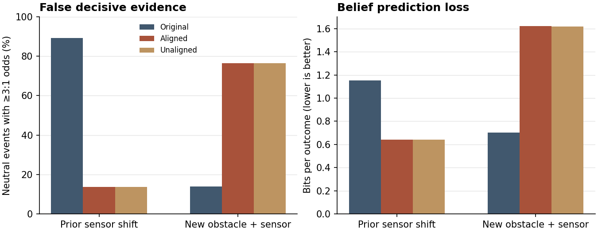

# Visual evidence under distribution shift

A simulated forward command can leave the observation unchanged because a wall blocks movement or because the current dynamics suppress forward movement. Updating the hidden-rule belief after every collision would destroy useful prior evidence. These experiments ask whether a 57-parameter readout can recover the distinction from RGB transitions.

The comparison fit three logistic heads on the same 1,024 events on 32 layouts. The original 56 features were compared with local aligned RGB-luminance features and a matched ablation that sorted patch intensities to remove within-patch pixel correspondence. Static context features, the update rule, model size and development calibration were shared where applicable. A deterministic geometry reader served as a separate reference.



| Calibrated forward outcomes | A0 Original | A1 Aligned | A2 Unaligned |
|---|---:|---:|---:|
| Prior sensor shift, bits/outcome | 1.154 | 0.640 | 0.640 |
| New banded capture and obstacle family, bits/outcome | 0.703 | 1.622 | 1.620 |
| New family, neutral events at least 3:1 / 920 | 128 | 704 | 704 |
| New family, correct evidence direction / 872 | 840 | 614 | 614 |
| New family, complete forward pairs / 544 | 276 | 52 | 52 |

Both spatial variants removed 40 of 48 old raw-distinct feature collisions, spanning five layouts. They produced no fully correct neutral-and-decisive witness sets at the preset evidence thresholds. Another 176 rows shared exactly the same visible input with an identifiable witness. A deterministic feature map gives those inputs the same vector. Their physical context cannot be recovered from that observation alone.

The early gains did not transfer to the new family. Raw loss already increased, then development calibration worsened it further. On new wall and closed-door probes the most harmful scores came from stationary visual context cues. The geometry reader stayed neutral on isolated blockers and completed 308/544 full forward-mode pairs. It still cost 1.224 bits per outcome, including wrong, confident predictions after switches. The new obstacle and sensor settings changed together, so the experiment cannot estimate their separate causal effects.

The original captured CPU pipeline took a median 144 µs per probe plus query, compared with 207 µs for alignment. These exclude simulator rendering and use the same query head. The spatial features added no learned parameters or persistent storage. All arms used 14 packed bytes of causal state. These figures describe the original hardware run.

```sh
python -m experiments.visual_evidence
```

The command refits the heads, checks raw and calibrated evidence, and replays the forward posterior from archived feature matrices. Geometry predictions come from the original replay. The export does not regenerate the simulator runs. [Feature extraction](../experiments/visual_features.py) · [Experiment settings](../configs/visual.json) · [Reference metrics](../results/visual_evidence.json)
